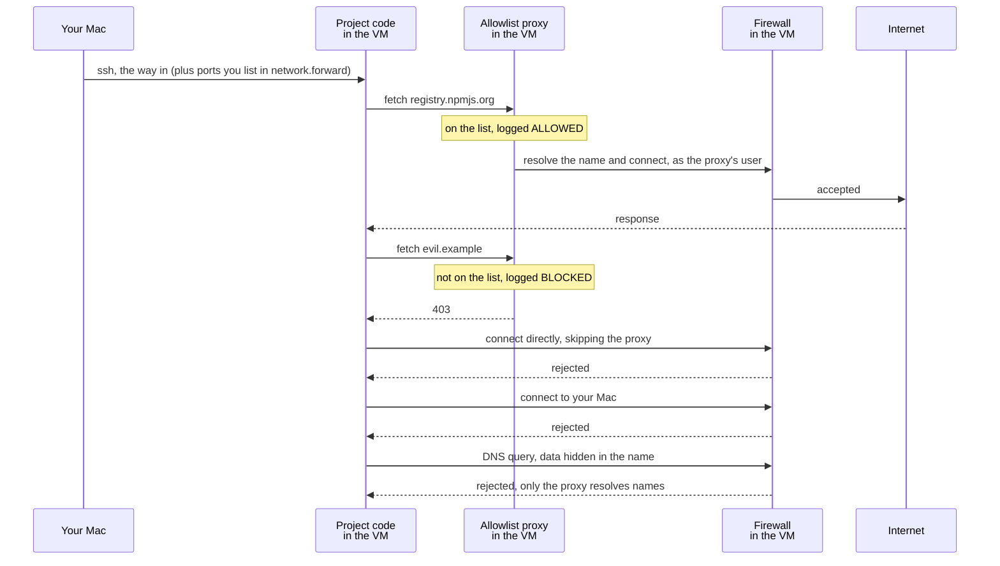
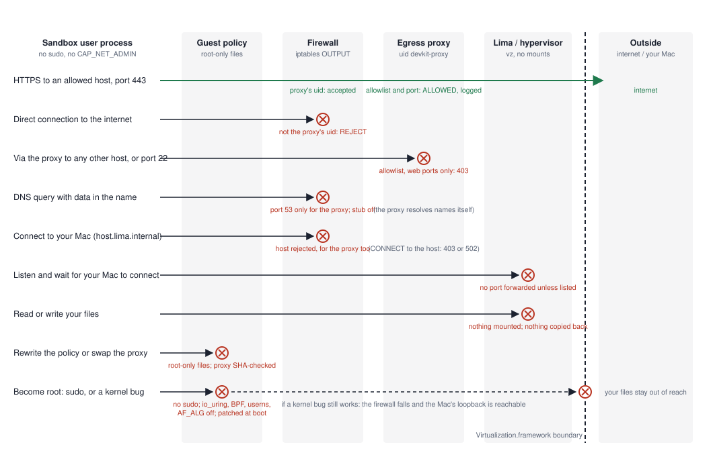

# devkit

One disposable virtual machine per project, so untrusted code and coding
agents can run without reaching your files, your services or the open
internet. macOS on Apple silicon, built on [Lima](https://lima-vm.io/).

> **Proof of concept.** Much of this code base was written with heavy AI
> assistance and has not had an independent review. Use with care until it is
> lifted out of PoC state, if ever. Expect rough edges; see
> [SECURITY.md](SECURITY.md) for what is and is not guaranteed.

## What you get

**Your Mac is out of reach.** A pull request's `npm install`, a Cargo build
script or an agent with shell access runs in its own Ubuntu VM with no shared
folders, no route to your Mac and no sudo. Files go in, never out: devkit has
no code path that copies anything from the VM to your Mac. The worst case is
a trashed VM, which `devkit rm` deletes.

**The internet is allowlisted and logged.** Only the hosts you name are
reachable. Every connection leaves through one proxy, which writes the host
to a log you can read with `devkit logs`. Nothing else can open a connection,
because the firewall only lets the proxy's own user out. One flag air-gaps the
machine once dependencies are in.

**Toolchains and dependencies are pinned.** Node, Go, Rust, Python, Ruby and
Java are installed by [mise](https://mise.jdx.dev) from a release devkit pins
by hash, checked against upstream signatures where they exist, and then locked
to the exact checksums seen on first install. Dependencies come from the
lockfile and nothing newer. Prefer Nix? `--toolchain nix` uses a `flake.nix`
instead.

**It works like a normal machine.** `devkit init` reads your version files and
writes one YAML file. `devkit up` builds the VM in about a minute. VS Code,
Cursor and Zed connect over SSH, and ports your app listens on appear on
`127.0.0.1`.

## Quick start

```bash
brew install lima
git clone https://github.com/jurajpiar/devkit.git && cd devkit
make install                # builds into ~/.local/bin; pass BINDIR=... to change
devkit doctor               # checks Lima, the proxy binary and the host

cd ~/code/some-project
devkit init                 # detects the languages used, writes devkit.yaml
devkit up                   # creates the VM, copies the code in, installs toolchains and dependencies
devkit shell                # a shell inside the VM, in ~/workspace
devkit logs                 # every host the sandbox tried to reach, allowed or blocked
devkit rm                   # delete the VM and everything in it
```

The first `devkit up` downloads the Ubuntu image (about 220 MB, checked
against a pinned digest), provisions the machine and installs the toolchains,
which takes a few minutes. After that, `up` takes seconds. Edit `devkit.yaml`
and run `devkit up` again to apply changes; the VM restarts if it has to.

Shell completion comes from `devkit completion`:

```bash
devkit completion fish > ~/.config/fish/completions/devkit.fish
devkit completion zsh > "${fpath[1]}/_devkit"        # or: eval "$(devkit completion zsh)"
```

To work from an IDE, connect with Remote-SSH to the host `devkit-<name>`.
devkit maintains that entry in `~/.ssh/config`, and `devkit connect` prints
the steps. Building from source needs Go 1.23 or newer; `make install` also
cross-compiles the proxy that runs inside the VM.

## How it works, in one picture



Three things make this hold. The VM has no shared folders and no sudo, so the
code sees an empty Ubuntu machine. A firewall written by root at boot lets
only the proxy's own user open connections, so a program that ignores the
proxy settings is rejected rather than let out; on every restart, until that
firewall is in place, a boot hold stops the sandbox opening any connection at
all, loopback included. And the proxy decides by
hostname and logs every attempt, which is what `devkit logs` shows. It does
not inspect content; TLS passes through untouched. Names are the proxy's job
too: by default the sandbox cannot send a DNS query at all, so a query name
cannot carry data out. `dns: resolvers` reopens DNS to the whole VM, for tools
that resolve a name before they use the proxy, and that channel with it.
`none` mode rejects everything, DNS included.

To see this for yourself rather than take it on trust, `examples/hostile-project`
is a project whose code tries to break out and reports, line by line, whether
each attempt was stopped. Run it, then loosen `devkit.yaml` and watch the
boundary give way exactly where you told it to.

## How escapes are stopped

Every arrow is something a malicious dependency or a misbehaving agent can try
from inside the VM, as the sandbox user. It travels right, towards your Mac and
the internet, until the first component that refuses it. One arrow gets
through: the audited path to an allowed host.

<picture>
  <source media="(prefers-color-scheme: dark)" srcset="docs/escape-map-dark.svg">
  
</picture>

Each stop is asserted by a test, most of them written red first: the escape
succeeded, then the design changed until it failed. The end-to-end suite
checks them on a real VM; the firewall rows are also checked in about a second
by `TestNetnsFirewall`, which loads the real rules into Linux network
namespaces, and the proxy rows by the proxy's unit tests. The third column is the part that matters when you read this as an
attacker: what it would still take to get through. Almost every answer is one
of four things, root in the guest, a loosening you chose in `devkit.yaml`, an
allowed host the attacker already controls, or a hypervisor escape.

| Attack vector | Stopped by | Still possible only if | Proven by |
|---|---|---|---|
| Direct connection to the internet | Firewall: only uid `devkit-proxy` may egress | Root in the guest flushes the firewall, or you set `sudo: true` | `direct connections bypassing the proxy are rejected`; `TestNetnsFirewall` |
| Proxy to another host, or to port 22 | Proxy: allowlist, ports 80 and 443 only | You list the host or port in `network.allow` or use `open` mode; or the attacker controls an allowed host, which the policy trusts by design | `allowed hosts are reachable on web ports only`; `TestProxyRefusesConnectToNonWebPort`, `TestHTTPAllowsOnlyWebPortsWithoutAPortEntry` |
| DNS query with data in the name | Firewall: port 53 only for the proxy's account; resolver stub off | You set `dns: resolvers`; or root in the guest; an allowed host the attacker controls makes DNS unnecessary anyway | `DNS is not a side channel`; `TestNetnsFirewall` |
| Send from a source port the proxy just used, riding its tracked DNS flow | Firewall: connection state is trusted only for root and the proxy; every other account may only reply on connections made to it | Root in the guest, or `sudo: true` | `DNS cannot ride another account's tracked connections`; `TestNetnsFirewall` |
| Connect to your Mac | Firewall: host rejected for every account, the proxy included | You set `allow_host: true`; or root in the guest, the one case the suite leaves red | `host is unreachable under every address form`; `TestNetnsFirewall` |
| Code planted in a login file (`~/.bashrc`, `~/.ssh/rc`) that runs during the next boot, before the firewall exists | Boot hold: until the firewall is applied, no new connection from the sandbox user or its container UIDs, loopback included, and no upstream DNS from systemd-resolved | Root in the guest, or `sudo: true` | `TestBootWindowIsClosed`; `TestNetnsFirewall` |
| Listen for your Mac to connect | Lima: forward nothing unless listed in `network.forward` | You list the port; or your IDE's own SSH tunnelling forwards it for you, which Lima never sees | `guest listeners are not forwarded to the Mac unless configured` |
| Read or write your files | Lima: `mounts: []`; devkit never copies out of the VM | You use `source: mount` with `mount_writable: true`, or pull output across yourself; or a hypervisor escape | `nothing from the VM lands on the host` |
| Rewrite the policy or swap the proxy | Root-only policy files; proxy installed only if its SHA-256 matches | Root in the guest; or the devkit binary or devkit.yaml on your Mac is tampered with, which is outside the sandbox entirely | `policy files are root-only` |
| Become root | No sudo; io_uring, unprivileged BPF, user namespaces and `AF_ALG` off; security pocket at boot | A kernel bug in a subsystem still reachable and not yet in the security pocket, or `sudo: true` | `unprivileged kernel attack surface is reduced`, `security updates are applied` |
| Root reaches your Mac's loopback services | Nothing inside the guest | The row above; your files still need a hypervisor escape on top | `TestRootInGuestReachesHost`, kept red on purpose |

Where the picture ends, and the risks that remain, are in [SECURITY.md](SECURITY.md).

## Configuration

`devkit init` writes this file. Edit it and run `devkit up` again to apply; the
VM restarts if the change needs it.

```yaml
name: my-project
source: copy            # copy | git | mount
# repo: https://github.com/you/repo.git   # for source: git
# branch: main

tools:
  manager: mise         # mise | nix | none, see Toolchains below
  versions:             # mise tool: version, seeded by devkit init
    node: "22"
    go: "1.27"
  containers: false     # rootless containerd + nerdctl inside the VM
  packages: [pkg-config]  # extra apt packages

# install: make deps    # replaces the lockfile-based install devkit picks

vm:
  cpus: 4
  memory_gb: 8
  disk_gb: 50

ssh_port: 2222

network:
  mode: allowlist       # allowlist | open | none
  allow:
    - registry.npmjs.org
    - github.com
    - "**.github.com"
  allow_host: false     # reach services on your Mac
  # dns: proxy          # proxy (only the proxy resolves names) | resolvers
  # forward: [3000]     # guest ports exposed on 127.0.0.1; nothing otherwise
  # distrust: [AAA Certificate Services]   # root CAs the VM must not trust

# exclude: [.git, node_modules]   # never copied into the VM (defaults apply)
# mount_writable: false           # source: mount only; lets the sandbox edit your files
# sudo: false                     # root inside the VM can disable the firewall
```

**Source methods**

| `source` | What happens | Notes |
|---|---|---|
| `copy` | The directory is copied into the VM on `up` and `sync` | Default. Host is never touched again. A git checkout gets a `.git` like a fresh clone's, see below. |
| `git` | Made by `devkit clone <url>`: your Mac clones bare, the VM checks out | Private repos work with your own credentials; the files are never written out on the Mac. `sync` fetches on the Mac and fast-forwards the VM. A `devkit.yaml` from `devkit init <url>` has no Mac-side clone; the VM then clones a public repo through the proxy. |
| `mount` | The directory is mounted read-only | Opt in. `mount_writable: true` lets the sandbox edit your files. |

**Git in a copied project.** Your `.git` is never copied. When the directory
is the top of a git checkout, the VM instead gets the `.git` a fresh clone
would have: your current commit and branch, with `origin` pointing at your
remote with any token stripped, and nothing else. No history, so a secret
deleted in an earlier commit stays on the Mac; no other branches, tags, stash
or reflog; no hooks; none of your `.git/config`. Uncommitted changes arrive as
changes, so `git status`, `git diff`, `git commit` and tools such as husky
work inside. A repository already in the VM is kept on later `sync`s, since it
may hold commits the Mac has never seen. Files in that one commit arrive even
if `exclude` names them.

**Cloning.** `devkit clone https://github.com/org/repo` (or just `devkit
github.com/org/repo`) makes `repo/` holding `devkit.yaml` and a bare,
one-commit clone in `.devkit/repo.git`, fetched with your own git credentials
so private repositories work. Bare means none of the project's files are
written out on your Mac, which rules out the class of git bugs that run code
on checkout; the VM checks out on `devkit up`. Languages are detected from
marker files read out of git objects. Only https and ssh are accepted, for the
clone and any redirect; `git://`, which GitHub no longer serves, is rewritten
to `https://`. `devkit sync` fetches new upstream commits on the Mac and
hands them to the VM, which never talks to the remote itself.

**Pushing from the VM.** The VM holds no credentials, and should not: a token
or SSH agent inside is usable by every dependency that runs there. `devkit
push` brings the work out instead. The VM writes a git bundle of the branch.
Your Mac has git check every object in it (malformed trees such as one with a
`.git` entry are refused), stores the branch as `refs/devkit/<project>/<branch>`,
outside your branches and work tree, and shows the commits, their authors,
the diffstat and any changed file that runs outside the VM: CI workflows, git
and editor hooks, `.envrc`, `package.json` scripts, task runners. After you
say yes it pushes with your normal git credentials. No git hooks run on the
Mac: a pre-push hook such as husky's would run the project's own code there,
and it already ran in the VM. The push never forces; `--force-with-lease`
replaces the remote branch only if it is still where it was when you reviewed.
Commits from the VM are unsigned; a branch that requires signatures needs
them re-signed on the Mac.

**Network modes**

| `mode` | Outbound traffic | Use |
|---|---|---|
| `allowlist` | Only hosts in `allow`, via the audited proxy; the firewall rejects everything else | Default |
| `open` | Any host, via the audited proxy; the firewall still rejects direct connections | Trusted code, want the log |
| `none` | Nothing, not even DNS | Air-gap after dependencies are installed: `devkit up --network none` |

Allowed hosts are hostnames: `example.com` exact, `*.example.com` one
level, `**.example.com` any depth. An entry allows the web ports, 80 and 443,
and nothing else on that host; `host:port` allows exactly one other port.
Anything else is rejected at validation. By default only the proxy may resolve
names: it looks up allowed hosts itself, and the sandbox cannot send a DNS
query at all, so a query name cannot carry data out. `dns: resolvers` reopens
DNS to the whole VM for tools that resolve a name before they use the proxy.

Nothing the sandbox listens on is reachable from your Mac unless its port is in
`forward`. A page served from the sandbox and opened in your browser would run
with the browser's unrestricted network, so forwarding is opt-in per port.

The guest applies Ubuntu's security pocket on every boot, before the firewall
comes up, so a VM does not stay at its image's patch level. Expect the cost on
the first boot after a kernel update lands: `devkit up` took about a minute
longer than usual the day one did (1 m 45 s against 46 s). Later boots only
check the pocket and take seconds. The new kernel is installed to disk and runs
from the next boot. `devkit up` does not reboot a VM whose configuration is
unchanged, so run `devkit down && devkit up` to boot into a new kernel; the
boot that installed it says so. `vm.security_updates: false` turns the step off;
`devkit up --no-security-updates` writes that for you, so the next boots are
quick again and the VM says so in its policy stamp.

**Trust store.** The VM trusts what Ubuntu's `ca-certificates` package
trusts, refreshed by root on every boot, so a VM created before a CA was
removed upstream catches up on its next start. `network.distrust` names roots
to remove on top of that, for the cases where the distro lags the browsers.
Runtimes that bring their own root list (Node, Python's certifi, pip, curl)
are pointed at the system bundle instead, so both the distro's updates and
your `distrust` list apply to them. `devkit up` ends with a short trust audit;
`devkit audit --deep` scans every file. See SECURITY.md for what it catches.

The sandbox cannot reach your Mac in any mode unless `allow_host` is true. With
`allow_host: true` the VM reaches the host directly at `host.lima.internal`,
bypassing the proxy and its log.

**Dependencies** are installed from whichever lockfile is present and from
nothing else: `npm ci`, `pnpm install --frozen-lockfile`, `yarn install
--frozen-lockfile`, `go mod download`, `cargo fetch --locked`, `uv sync
--frozen`, `bundle install`, and so on. Set `install:` when the guess is wrong.
A Node project without a lockfile gets `npm install` and a reminder to commit
the result.

**Containers** are opt-in. With `containers: true` the VM gets rootless
containerd and `nerdctl` for databases and services.

## Toolchains

`tools.manager` decides how language toolchains get into the VM. `devkit init`
picks `mise` unless `--toolchain` or `DEVKIT_TOOLCHAIN` says otherwise, and
seeds versions from the files it finds: `.nvmrc`, `engines.node`, `go.mod`,
`rust-toolchain.toml`, `.python-version`, `.ruby-version`, `.java-version`.
A Bun project, one with `bun.lock`, `.bun-version`, `bunfig.toml` or
`packageManager: "bun@..."`, gets Bun, beside Node when it has a
`package.json`, and its dependencies install with `bun install
--frozen-lockfile`. An `engines` range seeds its lower bound only when that
bound is inclusive, otherwise the default.

| | `mise` | `nix` | `none` |
|---|---|---|---|
| What you edit | `tools.versions` in `devkit.yaml` | `flake.nix` in the repo | `tools.packages` |
| Languages | Node, Go, Python, Ruby, Rust, Java, Zig, Bun, Deno, and CLIs from the aqua registry | Everything in nixpkgs | Whatever Ubuntu 24.04 ships |
| Pinning | `mise.lock` inside the VM, written on the first `up` | `flake.lock`, commit it | Ubuntu release |
| Download verification | Upstream checksums and signatures where published; GitHub attestations for Python and Ruby builds; `rustup-init` is unverified | Every store path checked against the cache's signing key; every input hashed in `flake.lock` | apt signatures |
| Disk per VM | A 30 MB binary plus each toolchain | A few hundred MB for Nix plus each toolchain's own closure | Nothing extra |
| Learning curve | None | You will edit `flake.nix` eventually | None |

**mise.** Root installs a pinned, hash-checked mise release at boot and
locks its settings in `/etc/mise/config.toml`: plugin backends (asdf, vfox)
are disabled because they are unreviewed shell scripts, provenance is checked
on every install, and releases younger than three days are skipped. The
sandbox user then installs `tools.versions` through the audited proxy. The
first `devkit up` records every download's URL and checksum in the VM's
`mise.lock`; every later `up` installs with `--locked` and refuses anything
else. Change a version and run `devkit up --relock`. The lock lives and dies
with the VM, because devkit never copies anything from the VM to your Mac. A
`mise.toml` or `.nvmrc` in the repository layers on top, as mise normally
does.

**nix.** Root installs a pinned, hash-checked multi-user Nix once; the daemon
fetches through the proxy, so `devkit logs` shows it. `devkit init --toolchain
nix` writes a `flake.nix` with a dev shell for the toolchains it detected,
unless the repo already has one. `devkit up` evaluates it, and `devkit shell`
drops you into `nix develop`. Commit a `flake.lock` from the host (`nix flake
lock`) when you want the inputs pinned for everyone; the one the VM writes
stays in the VM. IDE terminals over SSH are not inside the dev shell; run
`nix develop` there.

**none.** Only `tools.packages` from apt. Right for C and C++ projects, where
`build-essential`, `cmake` and `clang` from Ubuntu are usually what you want,
and for anything else you would rather install by hand with `install:`.

Rust is the weak spot in every column: `rustup-init` is fetched without a
signature check by mise, and nixpkgs' `rustc` is fine but `rustup` is not
there. Java through mise checks a catalogue checksum only; prefer
`packages: [openjdk-21-jdk]` under `none` or `mise` when that matters.
Solidity tooling is covered by npm (Hardhat) and by `binaries.soliditylang.org`
for solc, which both Hardhat and Foundry verify; install Foundry with
`install:` and pin its version.

## Commands

| Command | Description |
|---|---|
| `devkit clone <url> [dir]`, `devkit <url>` | New project from a repository, without checking it out on the Mac. `git://` becomes `https://`. Flags: `--branch`, `--name`, `--toolchain`, `--node`, `--network` |
| `devkit init [repo-url]` | Write `devkit.yaml`. Flags: `--name`, `--toolchain`, `--node`, `--network`, `--force` |
| `devkit up` | Create or start the VM, sync source, install toolchains and dependencies. Flags: `--network`, `--no-sync`, `--no-install`, `--relock` |
| `devkit shell [cmd]` | Shell in the VM, or run a command |
| `devkit sync` | Copy the directory again; for a cloned project, fetch upstream on the Mac and fast-forward the VM |
| `devkit push [branch]` | Review commits made in the VM and push them from your Mac with your own credentials. Flags: `--remote`, `--to`, `--yes`, `--force-with-lease` |
| `devkit logs [-f] [-n N]` | Egress audit log |
| `devkit connect` | IDE connection instructions |
| `devkit down [name]` | Stop the VM, keep its disk |
| `devkit rm [-f] [name]` | Delete the VM. Without a name, the current project's; completion lists the devkit VMs |
| `devkit ls` | List devkit VMs |
| `devkit doctor` | Check the host |
| `devkit audit [--deep]` | Report roots the VM, its runtimes or the project trust that Mozilla no longer does |

## Under the hood

- One Lima instance per project, `vmType: vz`, no host mounts, no sudo for the
  sandbox user beyond the three read-only commands Lima needs to confirm boot.
- A root-only provisioning script, regenerated from `devkit.yaml` on every boot,
  applies the firewall and starts the egress proxy. Code in the VM cannot change
  the policy because it has no root. Config values are validated against a
  strict grammar before they reach the script.
- Toolchain managers are installed by root from release archives pinned by
  SHA-256 in `internal/provision/provision.go`. The toolchains themselves are
  installed by the sandbox user, through the proxy, so they show in the log.
- The egress proxy is a small Go HTTP/CONNECT proxy embedded in the `devkit`
  binary. Root inside the VM copies the staged binary to a private location and
  installs it only if its SHA-256 matches the one recorded at provisioning time.
- In `allowlist` and `open` modes the firewall rejects every outbound packet
  except those from the proxy's user, DNS to the configured resolvers, and the
  host when `allow_host` is set. In `none` mode it rejects everything.

## What gets downloaded, and how it is verified

| Resource | Source | Verification |
|---|---|---|
| Ubuntu 24.04 Minimal cloud image | cloud-images.ubuntu.com, release pinned in `internal/lima/template.go` | SHA-256 digest pinned; Lima refuses a mismatch |
| mise | GitHub release pinned in `internal/provision/provision.go` | SHA-256 pinned; the pin was taken from the release's `SHASUMS256.txt` after checking its GPG signature (fingerprint `2485 3EC9 F655 CE80 B48E 6C3A 8B81 C9D1 7413 A06D`). No install script is run |
| Toolchains via mise | nodejs.org, dl.google.com, GitHub releases, as mise documents per tool | mise's per-tool checks (Node: `SHASUMS256.txt` plus OpenPGP; Go: published `.sha256`; Python, Ruby: GitHub attestations), then pinned by URL and checksum in the VM's `mise.lock` |
| Nix | releases.nixos.org, version pinned in `internal/provision/provision.go` | SHA-256 pinned, cross-checked against the hash in the official installer |
| Nix packages | cache.nixos.org, flake inputs | Nix verifies the cache's Ed25519 signature; `flake.lock` pins every input by hash |
| apt packages | Ubuntu archives | Ubuntu's signing keys shipped in the image |
| Project dependencies | Whatever the lockfile says, inside the sandbox | Lockfile integrity hashes, enforced by `npm ci` and friends |
| devkit's own Go modules | proxy.golang.org | `go.sum`; `go mod verify` passes |
| Lima | Homebrew | Homebrew's bottle checksums |

Bump the image deliberately: update the release path and both digests together
from the `SHA256SUMS` file for that release. Bump mise and Nix the same way:
verify the upstream signature, then change the version and both hashes.

## Project layout

```
cmd/devkit            CLI entry point
cmd/egressproxy       the proxy that runs inside the VM
internal/app          commands
internal/project      devkit.yaml schema and validation
internal/detect       language detection for devkit init
internal/lima         limactl wrapper and instance config rendering
internal/provision    scripts that run inside the VM (the security policy)
internal/egressproxy  proxy implementation
internal/embedded     embedded proxy binary
tests/e2e             creates a real VM and checks the guarantees
```

## Roadmap

- `devkit cp vm:path dest`: an explicit, user-initiated way to pull a file
  out of the VM, such as a build artefact or a test report. devkit itself will
  still never write to the host on its own; whatever comes out is treated as
  untrusted data, and you name both paths.
- Escape tests for `source: mount`, including a read-only mount refusing
  writes, in a VM of their own.
- `nix develop` for IDE terminals over SSH, probably through direnv.
- Rust toolchain verification: pin `rustup-init` by hash in devkit until mise
  verifies it.
- Foundry as a first-class, hash-pinned install for Solidity projects.
- An opt-in inner sandbox (gVisor) that runs project processes behind a
  userspace kernel, so a guest kernel exploit meets it before the real kernel.
  Defence in depth against the one case the VM boundary does not cover, a
  privilege escalation reaching the host's loopback; see SECURITY.md for the
  trade-offs.

## License

MIT
